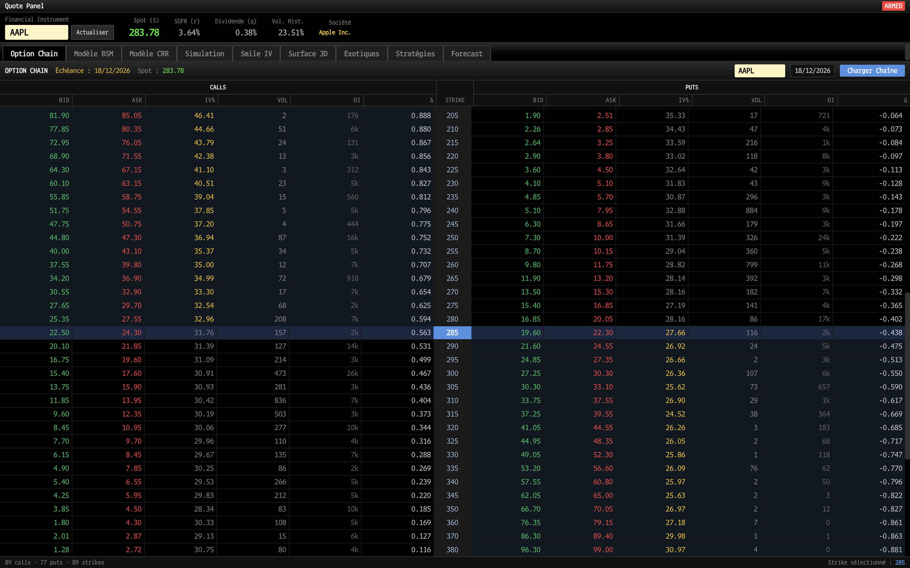
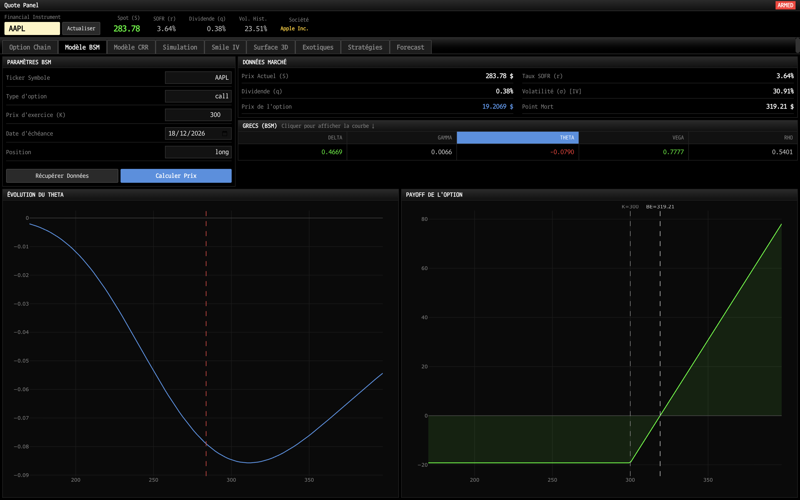
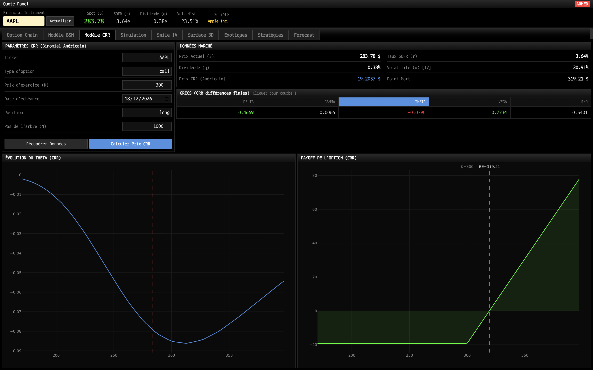
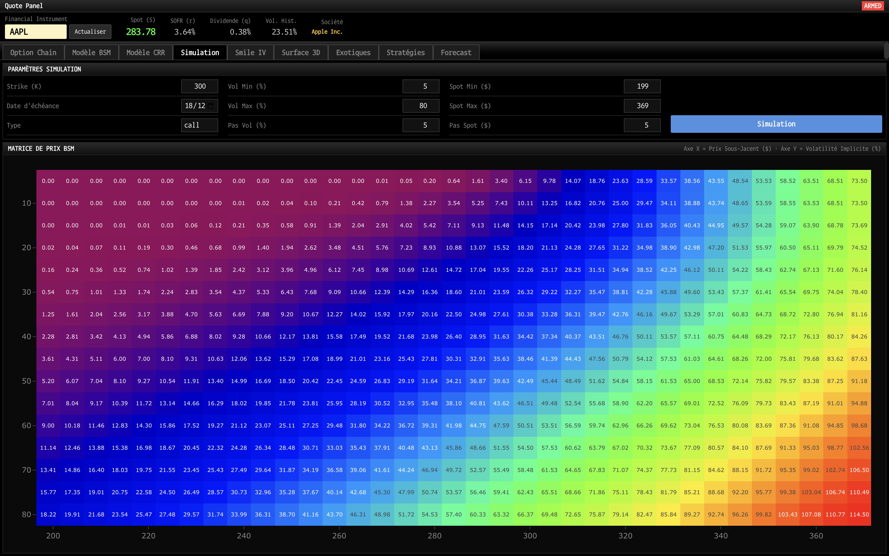
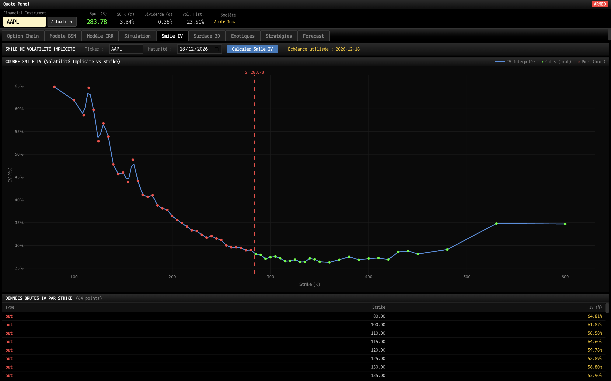
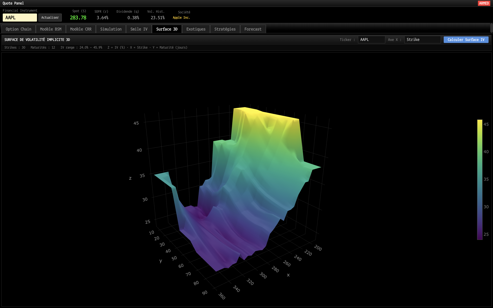
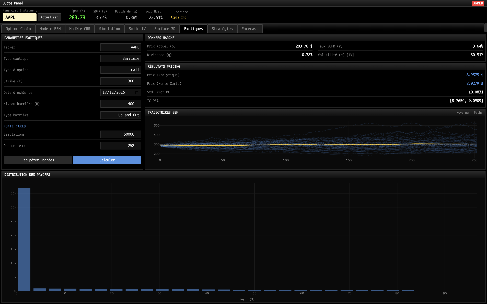
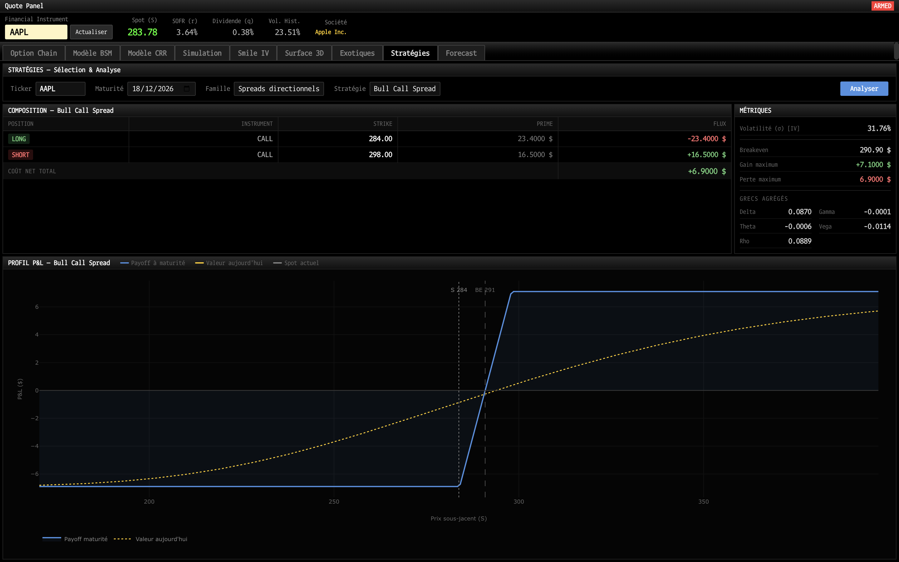

<h1 align="center">
  
  Option Pricer
</h1>

<p align="center">
  <a href="https://www.python.org/downloads/"></a>
  <a href="https://opensource.org/licenses/MIT"></a>
  
  <br>
  
  
  
  
  
  <br>
  
  
  
  
</p>

<p align="center">
  Application de pricing d'options financières vanilles et exotiques.<br>
  Frontend React/TypeScript statique avec backend FastAPI sans état, déployable sur Vercel. Données de marché en temps réel (Yahoo Finance & FRED).
</p>

---

## Fonctionnalités

### Modèles de pricing

| Modèle                                            |    Type    | Méthode                                          |
| :------------------------------------------------- | :---------: | :------------------------------------------------ |
| **Black-Scholes-Merton**                     | Européenne | Formule fermée analytique                        |
| **Cox-Ross-Rubinstein**                      | Américaine | Arbre binomial avec exercice anticipé            |
| **Rubinstein & Reiner (1991) + Monte Carlo** | Barrières | Analytique (4 types) + simulation GBM avec rebate |
| **Monte Carlo**                              |  Asiatique  | Moyenne arithmétique / géométrique             |
| **Monte Carlo**                              |  Lookback  | Prix extrême flottant / fixe                     |
| **BSM fermée + Monte Carlo**                |  Digitale  | Cash-or-Nothing analytique et numérique          |

### Données de marché en temps réel

- **Prix spot** via Yahoo Finance (`yfinance`) avec appel d'information mutualisé.
- **Taux sans risque SOFR** depuis l'API FRED de la Réserve fédérale américaine.
- **Dividendes** et **volatilité implicite** extraits automatiquement depuis les chaînes d'options.
- **Cache TTL thread-safe** pour optimiser les requêtes externes tout en garantissant un backend strictement sans état.

### Grecs

Delta ($\Delta$), Gamma ($\Gamma$), Theta ($\Theta$/jour), Vega ($\nu$, normalisé par point de vol de 1 %), Rho ($\rho$, pour 100 bps), calculés analytiquement (BSM) ou par différences finies (CRR).

---

## Architecture

L'application est architecturée pour un déploiement unifié sur **Vercel** : frontend Vite statique servi via CDN global et API Python Serverless exécutée par **FastAPI**.

```
┌─────────────────────────────────────────────────────────────┐
│                    Frontend React 18                        │
│   TypeScript · Vite 6 · Tailwind CSS 4 · Plotly.js (lazy)   │
│   8 onglets avec conservation d'état au montage             │
└──────────────────────────────┬──────────────────────────────┘
                               │
                               │ fetch() HTTP JSON
                               ▼
                    ┌─────────────────────┐
                    │  Proxy /api/ (Vite) │
                    │   ou Vercel Rewrite │
                    └──────────┬──────────┘
                               │
                               ▼
┌─────────────────────────────────────────────────────────────┐
│                    Backend FastAPI                          │
│   api/index.py (Serverless Vercel) / backend/main.py        │
│   Pydantic v2 (validation & schémas stricts)                │
│   Architecture 100 % stateless (sans état partagé)          │
└──────────────┬──────────────┬──────────────┬────────────────┘
               │              │              │
               ▼              ▼              ▼
           backend/        backend/       backend/
            logic/       data_fetcher     cache.py
           (pricing)   (yfinance + FRED)  (TTL local)
```

---

## Interface 8 onglets

### 1 · Option Chain

Carnet d'options en temps réel : strikes, bid/ask, IV implicite, volume, open interest et delta BSM pour calls et puts. Sélection de l'échéance parmi toutes les dates disponibles.



### 2 · Calculateur BSM

Pricing européen en temps réel avec récupération automatique de S, r, q et IV marché.



### 3 · Modèle CRR

Pricing américain par arbre binomial. Comparaison directe avec le prix BSM européen et grecs par différences finies.



### 4 · Simulation

Heatmap croisée volatilité $\times$ prix sous-jacent visualisant l'impact combiné de Gamma et Vega sur le prix de l'option. Plafond de calcul sécurisé pour l'exécution serverless.



### 5 · Smile de volatilité

Tracé IV vs Strike par inversion numérique de BSM (méthode de Brent) sur les prix mid Calls/Puts OTM.



### 6 · Surface IV 3D

Surface de volatilité implicite interactive (Strike ou Moneyness $\times$ Maturité $\times$ IV) avec budget temporel et limitation adaptative d'échéances pour des temps de réponse rapides.



### 7 · Options exotiques

Pricing analytique et Monte Carlo pour options barrières, asiatiques, lookbacks et digitales. Trajectoires GBM simulées, distribution des payoffs et profil à maturité.



### 8 · Stratégies

Construction et analyse de stratégies multi-legs prédéfinies ou personnalisées avec données de marché :

- **22 stratégies en 5 familles** : Positions de base, Spreads directionnels, Volatilité, Butterflies, Condors.
- **Métriques calculées** : coût net, breakevens, gain/perte maximum et grecs agrégés BSM.
- **Stratégies personnalisées** : ajout jusqu’à 50 jambes call/put, long/short, strike et échéance cotée propres à chaque jambe. La cotation exacte est utilisée si disponible, sinon une estimation BSM est signalée.
- La valeur théorique et les grecs sont agrégés à aujourd’hui pour les échéances propres à chaque jambe.
- Le payoff et ses maximums ne sont affichés que si toutes les jambes partagent une échéance.



---

## Benchmark vs DerivaGem (John Hull)


---

## Installation et Lancement

### Prérequis

- **Python 3.12+**
- **Node.js 18+** et **npm**
- Clé d'API FRED gratuite (pour le taux sans risque SOFR) : [Obtenir une clé FRED](https://fred.stlouisfed.org/docs/api/api_key.html)

### Configuration des variables d'environnement

Renseignez votre clé FRED dans un .env :

```env
FRED_API_KEY=votre_cle_fred_ici
```

---

### Lancement en développement local

#### Option 1 : Uvicorn + Vite Dev Server (recommandé)

```bash
# 1. Installer l'environnement Python
python3 -m venv venv
source venv/bin/activate       # Sur Windows : venv\Scripts\activate
pip install -r requirements-dev.txt

# 2. Installer les dépendances frontend
cd frontend
npm install
cd ..

# 3. Lancer le backend FastAPI (Terminal 1)
uvicorn backend.main:app --reload --port 8000

# 4. Lancer le frontend Vite (Terminal 2)
cd frontend
npm run dev
```

L'application est accessible sur `http://localhost:5173`. Le serveur de dev Vite transfère automatiquement les requêtes `/api/*` vers `http://localhost:8000`.

---

## Structure du projet

```
option-pricer/
├── api/
│   └── index.py                      # Point d'entrée Serverless Vercel (exporte `app`)
│
├── backend/
│   ├── main.py                       # Application FastAPI, CORS, gestionnaires d'erreurs
│   ├── schemas.py                    # Schémas Pydantic stricts pour les requêtes/réponses
│   ├── services.py                   # Orchestration métier (100 % stateless)
│   ├── health.py                     # Diagnostic GET /api/health (yfinance & FRED)
│   ├── data_fetcher.py               # Récupération données de marché (yfinance + FRED)
│   ├── cache.py                      # Cache TTL thread-safe en mémoire
│   ├── validation.py                 # Validation mathématique et financière
│   │
│   ├── logic/                        # Moteurs de calcul financier
│   │   ├── bsm_logic.py              # Black-Scholes-Merton & Grecs analytiques
│   │   ├── crr_logic.py              # Cox-Ross-Rubinstein (arbre binomial)
│   │   ├── exotic_options_logic.py   # Options barrières, asiatiques, lookback, digitales
│   │   ├── simulation_logic.py       # Heatmap de simulation et sensibilité
│   │   ├── strategy_logic.py         # Moteur des 22 stratégies d'options
│   │   ├── volatility_smile_logic.py # Calcul du smile de volatilité implicite
│   │   └── volatility_surface_logic.py # Surface 3D de volatilité
│   │
│   ├── tests/                        # Suite de tests de régression pytest
│   │   ├── conftest.py
│   │   ├── test_app.py               # Tests d'intégration FastAPI TestClient
│   │   ├── test_data.py              # Tests mocks data_fetcher & FRED
│   │   └── test_pricing.py           # Validations numériques vs DerivaGem
│   │
│   ├── requirements.txt              # Dépendances Python de production
│   ├── requirements-dev.txt          # Dépendances de dev (uvicorn, httpx, pytest)
│   └── pytest.ini                    # Configuration pytest
│
├── frontend/
│   ├── src/
│   │   ├── app/
│   │   │   ├── App.tsx               # Racine, layout Quote Panel, lazy loading des onglets
│   │   │   └── components/
│   │   │       ├── Plot.tsx          # Wrapper Plotly en lazy loading (React.lazy + Suspense)
│   │   │       ├── OptionChainTab.tsx
│   │   │       ├── BsmTab.tsx
│   │   │       ├── CrrTab.tsx
│   │   │       ├── SimulationTab.tsx
│   │   │       ├── SmileTab.tsx
│   │   │       ├── SurfaceTab.tsx
│   │   │       ├── ExoticsTab.tsx
│   │   │       └── StrategiesTab.tsx
│   │   ├── lib/
│   │   │   └── api.ts                # Client HTTP typé (fetch)
│   │   └── types/
│   │       └── api.ts                # Interfaces TypeScript de l'API
│   ├── package.json                  # Dépendances optimisées sans bibliothèques inutilisées
│   └── vite.config.ts                # Configuration Vite + proxy de développement /api
│
├── vercel.json                       # Configuration de déploiement Vercel
├── .python-version                   # Version Python 3.12 épinglée pour Vercel
└── README.md
```

---

## Tests

Exécution des tests de régression (les tests marqués `integration` sont exclus par défaut) :

```bash
python -m pytest -q
```

Les tests nécessitant un accès réseau peuvent être lancés séparément :

```bash
python -m pytest -m integration -q
```

Vérification du typage TypeScript et build frontend :

```bash
npm --prefix frontend ci
npm --prefix frontend run typecheck
npm --prefix frontend run build
```

---

## Licence

MIT : voir [`LICENSE`](LICENSE).
